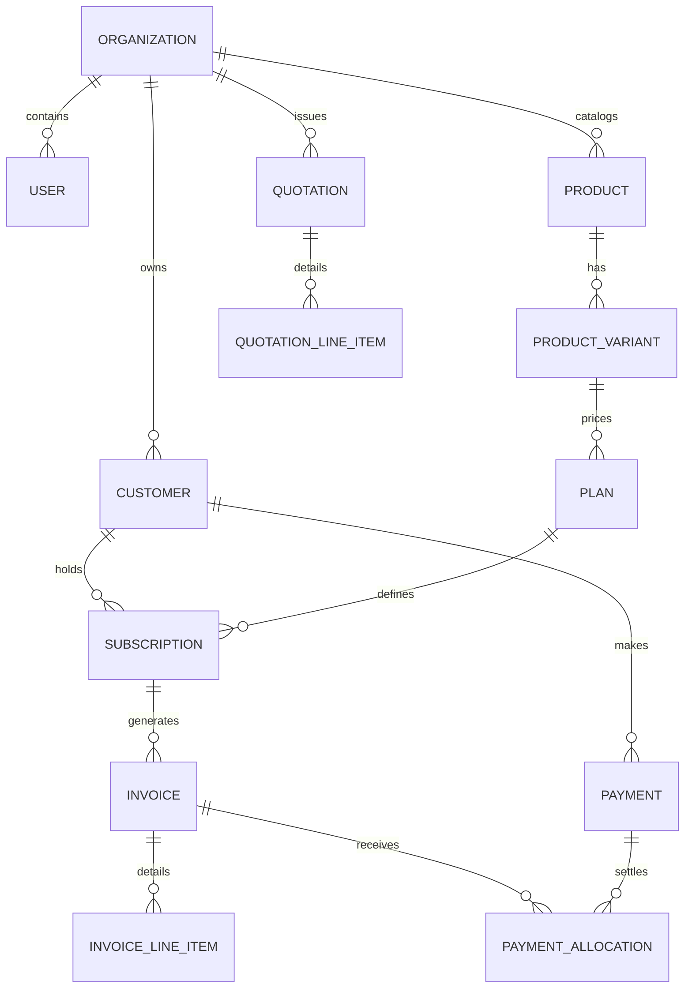

# Brightloop Database Design & Domain Model

## 1. Overview and Data Integrity Principles

Brightloop operates as a core financial and billing system of record. Consequently, database design adheres strictly to relational integrity principles:

1. **Foreign Key Integrity**: All entity associations must enforce database-level `FOREIGN KEY` constraints.
2. **Immutable Financial Records**: Invoices, transactions, and payment allocations must maintain immutable audit trails once finalized.
3. **Exact Currency Representation**: All monetary values must be stored as integers representing the smallest currency unit (e.g., cents, paise) or precision decimals to prevent floating-point rounding errors.
4. **Soft Deletions vs. Hard Deletions**: Core financial entities (invoices, payments, subscriptions) must never be hard deleted; status flags (`cancelled`, `voided`, `archived`) or timestamped soft deletion columns (`deletedAt`) are enforced.
5. **Auditing**: Every primary entity table must record `createdAt` and `updatedAt` timestamps.

---

## 2. Conceptual Domain Entities

### 2.1 Entity Responsibilities

- **Organization / Tenant**: Multi-tenant namespace isolating customer data, product catalogs, and financial accounts.
- **User & Role**: Authentication identity, session tracking, and granular RBAC role assignments.
- **Customer**: Billing identity, contact information, billing currency, and payment preferences.
- **Product & ProductVariant**: Catalog items representing software tiers, add-ons, physical goods, or services.
- **Plan**: Pricing configuration binding a product/variant to a recurring interval (`DAILY`, `WEEKLY`, `MONTHLY`, `YEARLY`).
- **Quotation**: Formal price quote for customer review before converting into an active subscription.
- **Subscription**: The active recurring contract governing renewal cadences, current state (`ACTIVE`, `PAST_DUE`, `PAUSED`, `CANCELLED`), and billing dates.
- **Invoice & InvoiceLineItem**: Itemized bill generated for subscription cycles or ad-hoc charges.
- **Payment & PaymentAllocation**: Manual or automated payment transaction records mapped to invoices.
- **TaxRate & Discount**: Reusable tax rules and promotional discounts applied to line items or totals.

---

## 3. Phase 0 Schema Implementation Boundary

> [!IMPORTANT]
> In accordance with Phase 0 architectural rules, **only a minimal valid schema** is implemented at this stage. The full domain schema detailed above will be introduced incrementally across subsequent phases:

- **Phase 0 Scope (Current)**:
  - Valid `schema.prisma` configuration with PostgreSQL provider and client generator.
  - Initial `SystemHealth` / foundational health entity to verify Prisma client generation, migrations, and database connectivity.
- **Deferred to Phase 1 (Auth & Users)**:
  - `User`, `Account`, `Session`, `Role`, `Permission`.
- **Deferred to Phase 2 (Catalog & Pricing)**:
  - `Product`, `ProductVariant`, `Plan`, `TaxRate`, `Discount`.
- **Deferred to Phase 3 (Subscriptions & Billing Engine)**:
  - `Customer`, `Quotation`, `Subscription`, `Invoice`, `InvoiceLineItem`, `Payment`, `PaymentAllocation`.
