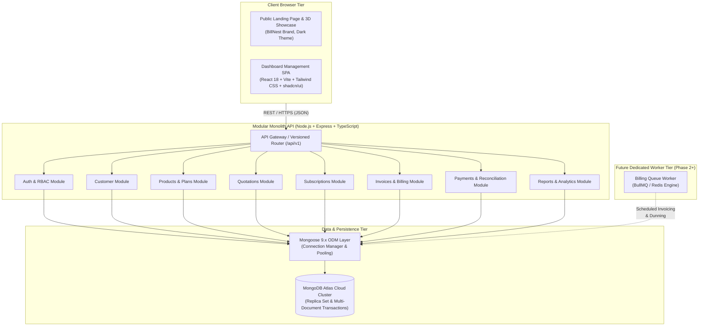

# BillNest System Architecture Overview

## 1. Architectural Strategy: Modular Monolith

BillNest is structured as a **Modular Monolith**. It pairs a modern single-page application (SPA) with a unified, domain-partitioned backend service running on top of a managed **MongoDB Atlas** cloud cluster with **Mongoose 9.x**.

This topology provides:

1. **Developer Velocity**: Single codebase, shared TypeScript definitions, unified testing, zero inter-service network latency during development.
2. **Strict Domain Boundaries**: Internal modules communicate through explicit service interfaces rather than raw ad-hoc database queries.
3. **Operational Simplicity**: Single deployment artifact for the API and static asset hosting for the frontend.
4. **Extraction Readiness**: Modules can be carved out into independent microservices if scaling requirements demand it in the future.

---

## 2. High-Level Architecture Diagram

---

## 3. Tier Responsibilities

### 3.1 Frontend Tier (`client`)

- **Technology**: React 18, Vite, TypeScript, Tailwind CSS, shadcn/ui components, TanStack Query, React Router, Lucide icons.
- **Responsibilities**:
  - Public marketing landing page with interactive 3D subscription showcase.
  - Interactive, responsive administrative dashboard.
  - Client-side routing, route guard enforcement, and state management.
  - Server-state caching, optimistic updates, and background refetching via TanStack Query.
  - Schema-driven client form validation matching backend contracts.

### 3.2 Backend Tier (`server`)

- **Technology**: Node.js, Express, TypeScript, Zod schema validation, Mongoose 9.x.
- **Responsibilities**:
  - Centralized request routing, logging, error normalization, and rate limiting.
  - Strict input sanitization and Zod-based request validation.
  - Business domain logic encapsulated in dedicated module services.
  - Transactional data access via Mongoose with multi-document client sessions.
  - Non-blocking health check probes (`/health/live` and `/health/ready`).

### 3.3 Data Tier (MongoDB Atlas)

- **Technology**: MongoDB Atlas Cloud Cluster with Mongoose 9.x.
- **Responsibilities**:
  - Document-oriented persistence with native schema validation and indexing.
  - High write performance with embedded subdocuments for high-cohesion line items.
  - ACID-compliant multi-document transactions enabled by replica set topology.
  - Centralized connection pooling (`maxPoolSize: 10`, `minPoolSize: 0`, `serverSelectionTimeoutMS: 5000`).

### 3.4 Future Worker Tier (Billing Scheduler)

- **Technology**: BullMQ / Redis worker processes (scheduled for Phase 2/3).
- **Responsibilities**:
  - Offloading long-running recurring billing cycles, invoice PDF generation, automated overdue notices, and background aggregation jobs away from the synchronous HTTP request path.

---

## 4. Module Boundaries & Communication Rules

1. Modules inside `server/src/modules/` must keep domain models, controllers, and services scoped within their own folder.
2. Cross-module operations must go through exposed domain service functions, never directly reaching into another module's internal repository logic.
3. Database transactions that span multiple modules must be orchestrated at the service boundary using Mongoose client sessions (`session.withTransaction()`).
